# Textmode City

Seamlessly looping procedural scenes rendered through classic text-art character sets
(ASCII, ANSI/CP437 blocks, PETSCII, teletext, braille, box-drawing, or any characters you
type), built for exporting VJ clips to Resolume. Plain HTML and JavaScript, no image
assets: every scene is drawn by code, and every motion repeats a whole number of times per
loop, so the last frame flows straight back into the first.

**[Try it live →](https://gghostdadd.github.io/textmode-city/)**

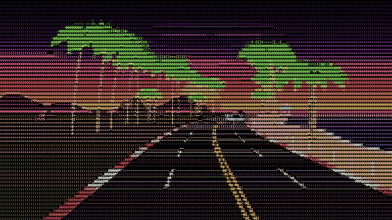

| | | |
|---|---|---|
| 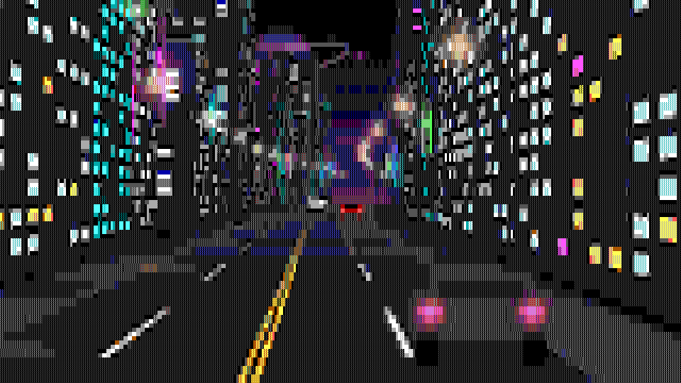 | 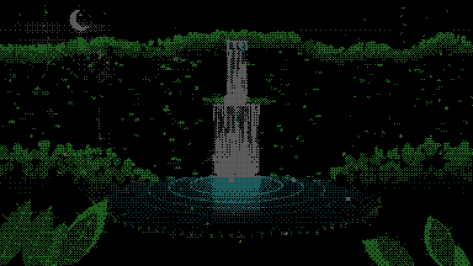 | 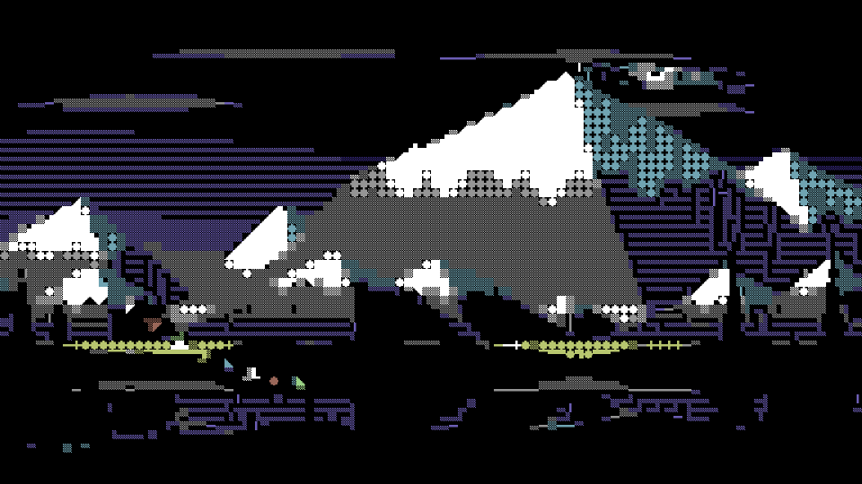 |
| Neon Avenue · ANSI blocks | Jungle Falls · braille | Himalaya · PETSCII |
| 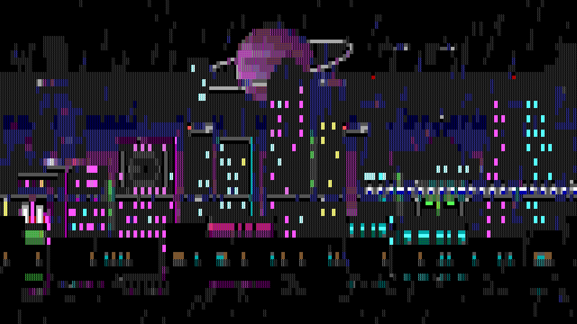 | 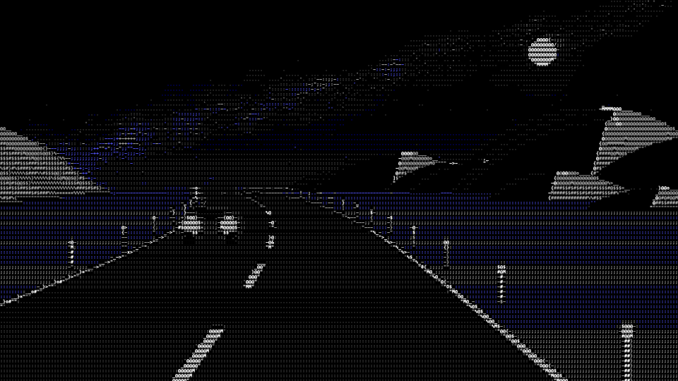 | 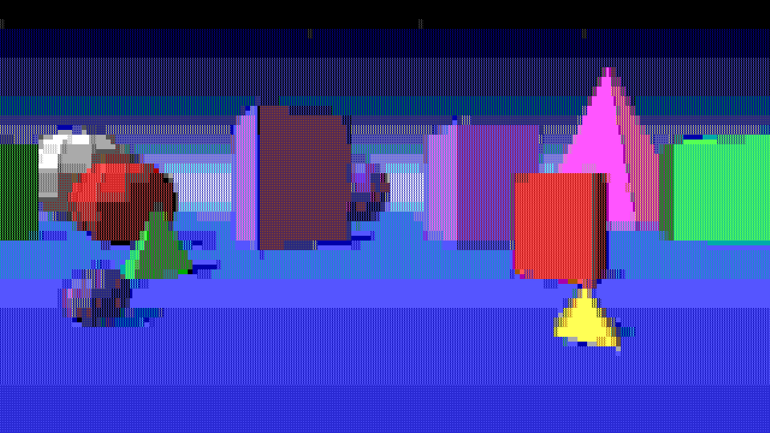 |
| Neon City · ANSI blocks | Desert Night · ASCII | Primitives · ANSI blocks |
| 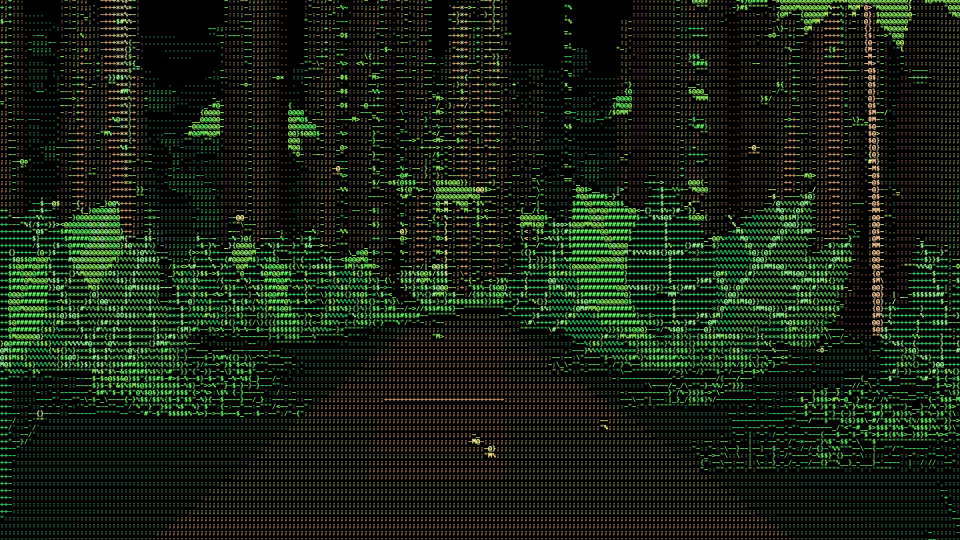 | 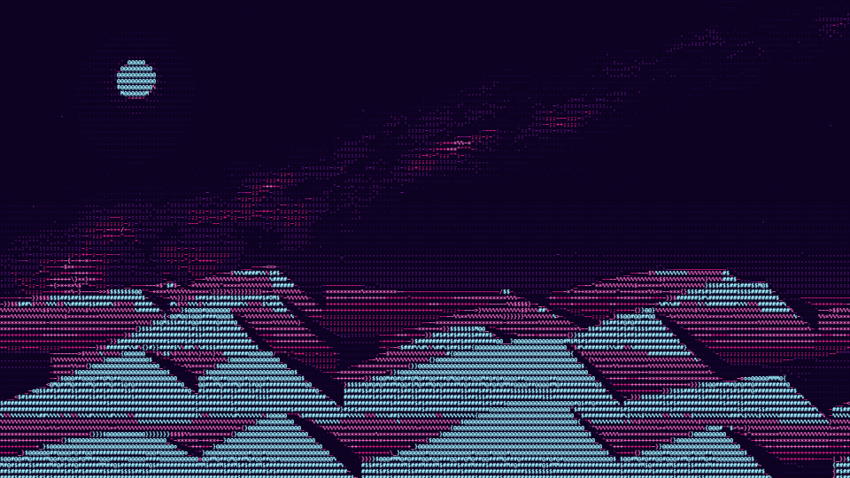 | 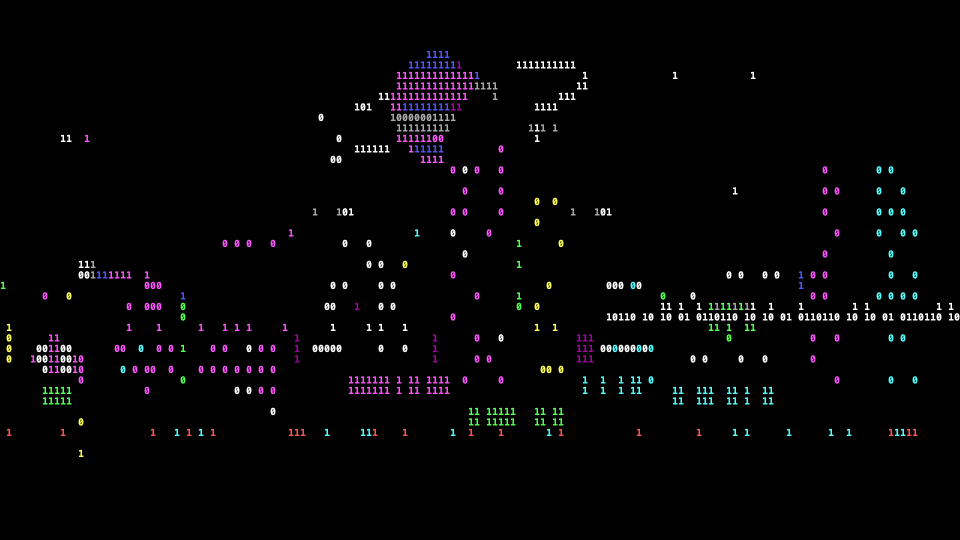 |
| Jungle Trail · ASCII truecolor | Dune Sea · Synthwave gradient | Neon City · custom `01` |
| 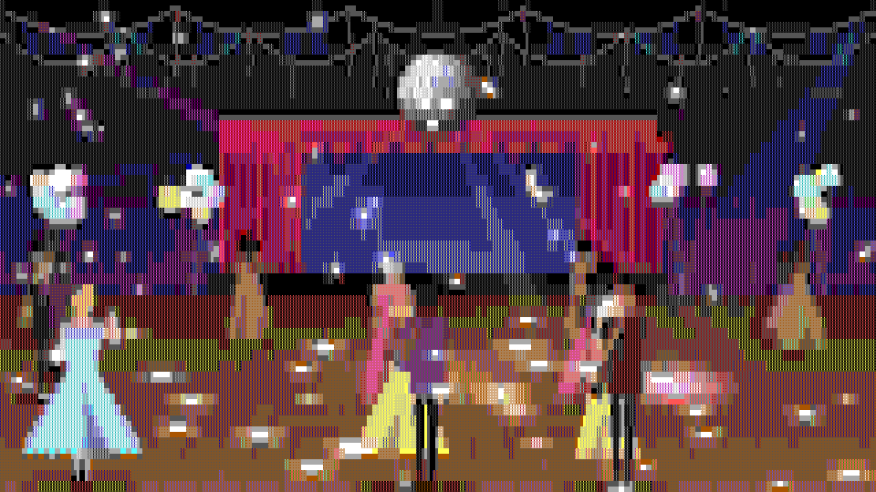 | 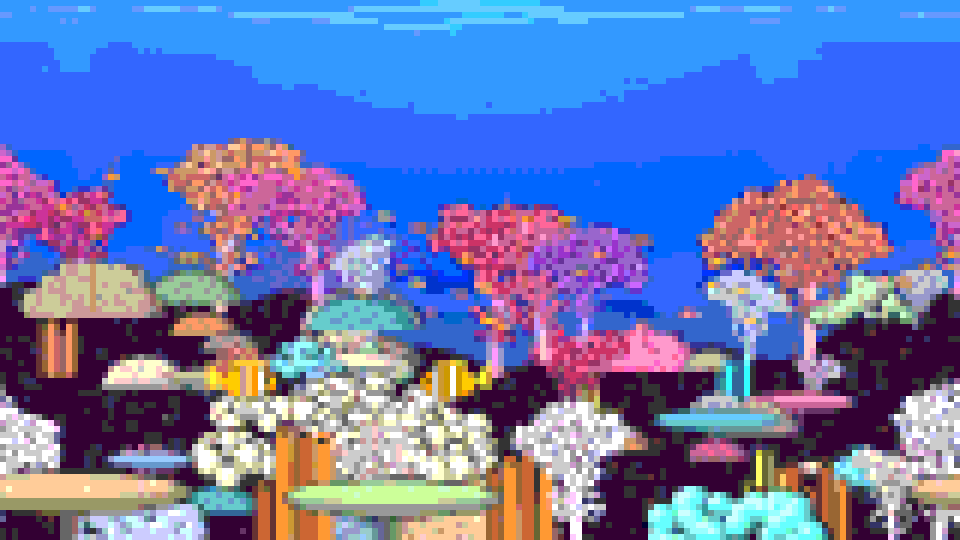 | 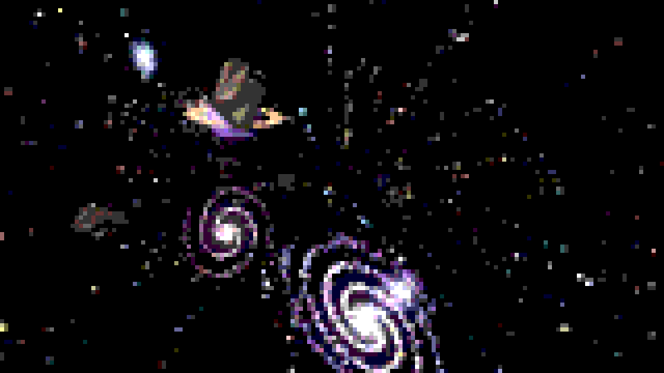 |
| School Dance · ANSI blocks | Coral Reef · ANSI blocks truecolor | Space Flight · ANSI blocks truecolor |
| 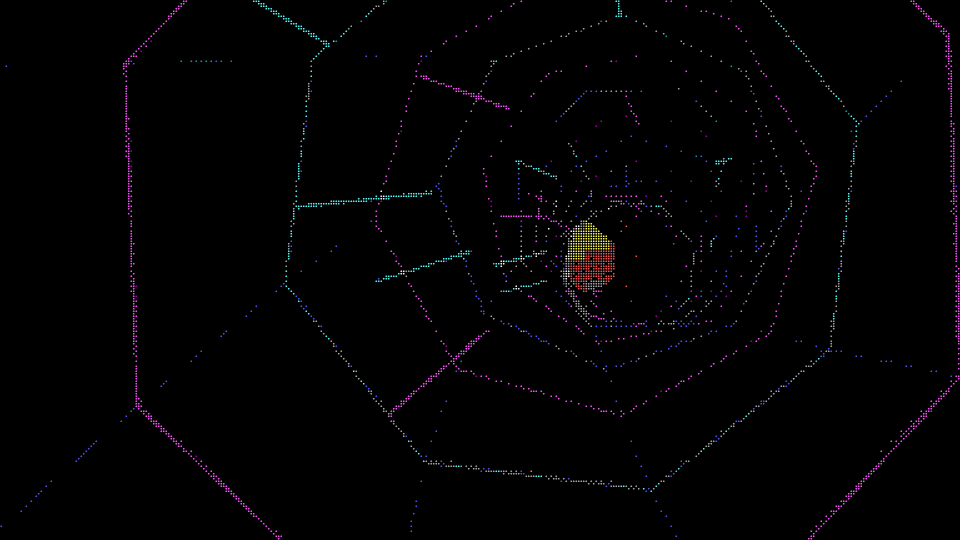 | | |
| Neon Tunnel · braille | | |

## Quick start

Open `index.html` in a browser, or serve the folder (for example `npx serve .`) and open
the page. Pick a scene, a character mode and a palette from the panel, then export:

```
npm install
npm run export -- "scene=dcoast&mode=ascii&palette=truecolor&cols=240&loop=8&fps=30"
```

The panel's **Copy export cmd** button gives you that line for the current settings.
Keys: `H` hide panel, `Space` pause, `1`–`7` modes, `,` `.` step frames.

## How it works

Each scene is drawn to a small canvas (about 4×4 samples per character cell). The engine in
[index.html](index.html) reads those samples per cell and each mode turns them into glyphs:
ASCII and custom sets are shape-matched against real font glyphs, blocks mix CP437 shades
and half blocks under ANSI colour rules, teletext and braille switch individual dots with
ordered dithering, and so on. Glyphs are cached as raw pixels and copied into one buffer per
frame. The seed sets each scene's layout; the same settings always give the same frames.

## Scenes

| Scene | File | What's in it |
|---|---|---|
| Neon City | [scenes/city.js](scenes/city.js) | Ringed planet, megastructures, searchlights, towers with neon trim and holo billboards (pixel invader, equalizer, ticker, radar), flying traffic, monorail, rooftops, rain, wet street |
| Jungle Falls | [scenes/falls.js](scenes/falls.js) | Twilight gorge: a cliff wall spanning the frame with a centred two-tier waterfall and a thin side stream, centred oval pond with ripples spreading from where the water lands, rim boulders with lapping foam, mist and spray, canopy, hanging vines, big foreground leaves, light shafts, fireflies, drifting leaves, one fish leap per loop |
| Himalaya | [scenes/mountains.js](scenes/mountains.js) | Giant snow ranges at alpenglow (lit faces pink, shadow faces blue, couloirs), lenticular clouds, snow plume off the highest summit, mist, forested foothills, alpine lake reflection, pines and fluttering prayer flags |
| Dune Sea | [scenes/desert.js](scenes/desert.js) | Moonlit dunes in five overlapping ridges with diagonal crest shadows and wind ripples, sand streaming off crests, Milky Way, twinkling stars, one shooting star per loop |
| Pacific Coast | [scenes/coast.js](scenes/coast.js) | Sunset highway drive: striped sun and glittering sun path, waves breaking on the beach, pier with lamps, headlands with cliff-top house lights, lifeguard tower, clusters of arcade-sprite palms (Cruis'n USA style: ringed tan trunks, full drooping green crowns), streetlamps, traffic both ways |
| Primitives | [scenes/primitives.js](scenes/primitives.js) | Old-school 3D: a blue plane with grid lines under a gradient sky, rows of flat-shaded cubes, pyramids, cones and faceted spheres (some spinning) with drop shadows; parallax slides the rows 1 to 4 widths per loop |
| School Dance | [scenes/prom.js](scenes/prom.js) | Vintage prom in the school gym: a big mirror ball top middle throwing light spots that sweep over the walls, floor and dancers as it turns, haze beams, couples in three rows turning in 3D about each other (50s/60s silhouettes in real proportions: gowns and tea-length dresses, tuxes, bouffants, pompadours; arms are limbs with hands that rest on a partner's back, shoulders or waist; some slow-dance and sway, others spin two or three times per loop in an open hold with skirts flaring), crepe-paper streamers, balloon clusters, a curtained stage with a starry backdrop and paper moon, two pin spots circling the varnished floor, confetti |
| Coral Reef | [scenes/reef.js](scenes/reef.js) | A crowded reef in deep blue water: red, pink, orange and purple soft-coral trees, boulder, cauliflower and brain corals, white bushy corals, sea fans, tube sponges and plate corals covering the reef face, all outlined so they stand apart, a pulsing bubble-tip anemone with a clownfish pair, a swarm of hovering anthias, chromis schools, a swaying sea whip, far-off fish, light shafts, bubbles, marine snow |

### 3D drive scenes

A second group in the Scene dropdown puts the camera *in* the scene, travelling toward the
horizon with everything coming at you, OutRun / Cruis'n style. They share an engine in
[scenes/drive.js](scenes/drive.js): a closed track of road segments with periodic curves
and hills; the camera drives exactly one lap per loop, so clips are seamless. Roadside
objects are pre-rendered sprites scaled by distance; buildings are 3D boxes; traffic laps the
track a whole number of times per loop (slower cars you pass, oncoming headlights).

| Scene | File | What's in it |
|---|---|---|
| Neon Avenue | [scenes/drive-city.js](scenes/drive-city.js) | Down the middle of a night street: 3D buildings with lit windows and neon roof trim, blade signs, street lamps, traffic, flying cars, skyline and planet |
| Coast Highway | [scenes/drive-coast.js](scenes/drive-coast.js) | Twisting beach highway at sunset: Cruis'n palms, surf washing up the beach, guardrail, lifeguard towers, rocks, traffic both ways |
| Mountain Pass | [scenes/drive-mountains.js](scenes/drive-mountains.js) | Winding, rolling alpine road: giant alpenglow peaks passing on both sides, the great range on the horizon, snowy pines, prayer flags across the road twice per lap |
| Desert Night | [scenes/drive-desert.js](scenes/drive-desert.js) | Two-lane road over moonlit dunes: dunes with shadowed slip faces, glinting reflector posts, Milky Way, shooting star, oncoming headlights |
| Jungle Trail | [scenes/drive-jungle.js](scenes/drive-jungle.js) | Walking a dirt trail: ferns, big-leaf plants, mossy trunks with vines, palms, vines hanging over the path, light shafts, fireflies, head bob |
| Primitive Drive | [scenes/drive-prims.js](scenes/drive-prims.js) | A black road winding across a blue grid plane between flat-shaded primitives (low-poly meshes in [scenes/prims.js](scenes/prims.js)), giant landmark shapes farther out |
| Space Flight | [scenes/drive-space.js](scenes/drive-space.js) | A vintage video-game starfield: square pixel stars rushing out from the centre with fading trails, pixel-art spiral and elliptical galaxies flying past and swelling to fill the screen, the occasional pixel-shaded planet (some ringed) and tumbling low-poly asteroid, a faint dust band, tiny far galaxies, twinkling fixed stars, gentle banking |
| Neon Tunnel | [scenes/drive-tunnel.js](scenes/drive-tunnel.js) | Synthwave tunnel: a twisting, snaking tube of dark panels edged in neon, light pulses rushing toward the camera, sparks streaking past, a striped sun beyond its open end, the camera banking into the curves |

Space Flight and Neon Tunnel fly rather than drive, so they don't use the road engine: their
worlds repeat every so many units of depth (the tunnel's path is a sum of sines with whole
periods over that length) and the camera covers it a whole number of times per loop.

The Parallax checkbox doesn't apply to these; they are always moving. Speed is fixed per
scene (the track gets longer with longer loops), except on very short loops where the track
has a minimum length and the camera moves faster.

**Parallax** scrolls layers by whole screen widths per loop, so it is seamless. Pair it with
the 24 or 32 s loop lengths. Neon City: far ½, towers 1, rooftops 2. Himalaya: great range
fixed, mid range 1, foothills 2, foreground 3. Dune Sea: three nearest ridges 1, 2, 3. Pacific
Coast: headlands/pier/beach 1, palms/lamps/rail 2, road markings 3. Coral Reef: far reef 1,
main reef 2, foreground corals 3. School Dance: the rows of dancers drift round the floor (back row one
way, the front rows the other). Jungle Falls only drifts its clouds.

**Tighter text**: Columns goes up to a third of the output width (cells are whole pixels,
so neighbouring values can share a cell size; the readout shows the real count). For the
cleanest fine text, set **Output** to 4K: the same columns get 2× the pixels per glyph.

## Modes

| Key | Mode | How it works |
|---|---|---|
| 1 | ASCII | Shape-matches each cell against real font glyphs; flat areas use a density ramp |
| 2 | ANSI blocks (CP437) | `░▒▓█▀▄▌▐` with 16 fg / 8 bg colours, the DOS ANSI-art rules |
| 3 | PETSCII (C64) | 8×8 C64-style graphics characters on the blue screen |
| 4 | Teletext mosaic | 2×3 sextant blocks in the 8 teletext colours |
| 5 | Braille dots | 2×4 dot cells with ordered dithering |
| 6 | Box-drawing lines | Traces thin strokes and outlines with `─│┌┼╱╲` glyphs |
| 7 | Custom characters | Type any characters into **Chars**; each is measured and the scene is rebuilt from only those |

Custom sets can be anything: `01`, `░▒▓█`, `·•●○`, kanji, emoji. Glyphs are shape- and
density-matched, so include a spread from light to heavy for the best result. Wide sets
(CJK, emoji) automatically get square cells and fewer columns. Colour emoji keep their own
colours regardless of palette. The set travels in the URL/export command as `chars=`.

Any palette works with any mode. The Palette dropdown has three groups:
- **Retro hardware**: ANSI/VGA 16, C64 (blue or black screen), Teletext, ZX Spectrum, CGA (two
  variants), PICO-8, Game Boy, green/amber phosphor, mono, truecolor
- **Color sets**: Vaporwave, Neon night, Jungle, Pastel, Earth tones
- **Gradient maps**: recolour the scene by brightness, dark to light: Sunset, Ocean, Fire, Ice,
  Matrix, Sepia, Synthwave, Toxic

**Hue** rotates and **Sat** scales the scene's colours before the palette is applied, so they
work with every palette (most directly with Truecolor). CRT adds bloom, scanlines and vignette.

**Density** (0.25×–3×) sets how many objects a scene places: shapes in Primitives;
buildings, traffic and flying cars in the cities; palms, rocks and cars on the coast; pines,
peaks and trees in the mountains; dunes and stars in the desert; ferns, trees, vines and
fireflies in the jungle; rain, fireflies and drifting leaves elsewhere. Chance-placed objects
keep their positions as you turn it up (more are added around them); counted rows such as
Primitives' shapes respace evenly.

**Loop** is the clip length in seconds and **fps** the frame rate (8, 10, 12, 18, 24, 25, 30
or 60); frames per clip = loop × fps. Low frame rates give a choppier, more retro motion.

## Controls

| Control | What it does |
|---|---|
| Scene | Side-view scenes, or the **3D drive** group where the camera travels through the scene |
| Mode / Chars | Character set (see Modes); typing in **Chars** switches to custom characters |
| Palette | Retro hardware, colour sets or gradient maps (see below) |
| Columns | Character columns; up to a third of the output width |
| Black / Gain | Brightness floor and contrast before characters are chosen |
| Dither | Ordered dithering strength for teletext and braille |
| Hue / Sat | Rotate and scale the scene's colours before the palette is applied |
| Density | How many objects a scene places (0.25×–3×) |
| Seed | Scene layout |
| Output | 1920×1080, 2560×1440 or 3840×2160 |
| Loop / fps | Clip length in seconds and frame rate; frames per clip = loop × fps |
| CRT | Bloom, scanlines and vignette |
| Parallax | Side-view scenes: scroll the layers, seamlessly, by whole screen widths per loop |

## Export to video

```
npm install
npm run export -- "<settings from Copy export cmd>" [name]
```

Frames are rendered headlessly to `renders/<name>/frame_00000.png…`, then encoded to
`renders/<name>_hapq.mov` (HAP Q), which plays on the GPU in Resolume and scrubs, loops and
reverses cleanly. HAP Q holds sharp glyph edges better than plain HAP. For maximum fidelity
on very fine text you can instead drop the PNG folder into Resolume Alley and encode DXV3
High Quality.

Requirements:
- **Node 18+**
- **Chrome**: the exporter uses `CHROME_PATH` if set, then a puppeteer-installed
  chrome-headless-shell in `~/.cache/puppeteer`
  (`npx @puppeteer/browsers install chrome-headless-shell@stable --path ~/.cache/puppeteer`),
  then Google Chrome in `/Applications` on macOS.
- **ffmpeg with HAP** (built with snappy). On macOS: `brew install ffmpeg-full` (keg-only;
  the exporter finds it). Elsewhere put a HAP-capable ffmpeg on `PATH` or set `FFMPEG`.
  Without HAP it falls back to ffmpeg's native DXV encoder (normal quality); without ffmpeg
  you still get the PNG sequence.

URL/query options (also accepted by the page itself, so a settings string doubles as a
preset): `scene mode palette chars density hue sat cols black gain dither seed loop fps crt pan w h`.

## Adding a scene

Create `scenes/<name>.js` that registers `SCENES.<name> = { label, gen(seed, loop), draw(u) }`
(add `group: '3D drive'` to list it with the drive scenes), then add a `<script>` tag for it
in `index.html`. Helpers live in [scenes/common.js](scenes/common.js) (layers, density) and
[scenes/drive.js](scenes/drive.js) (the 3D road engine). The one rule: anything that moves
must complete a whole number of cycles per loop.

## License

[MIT](LICENSE)
